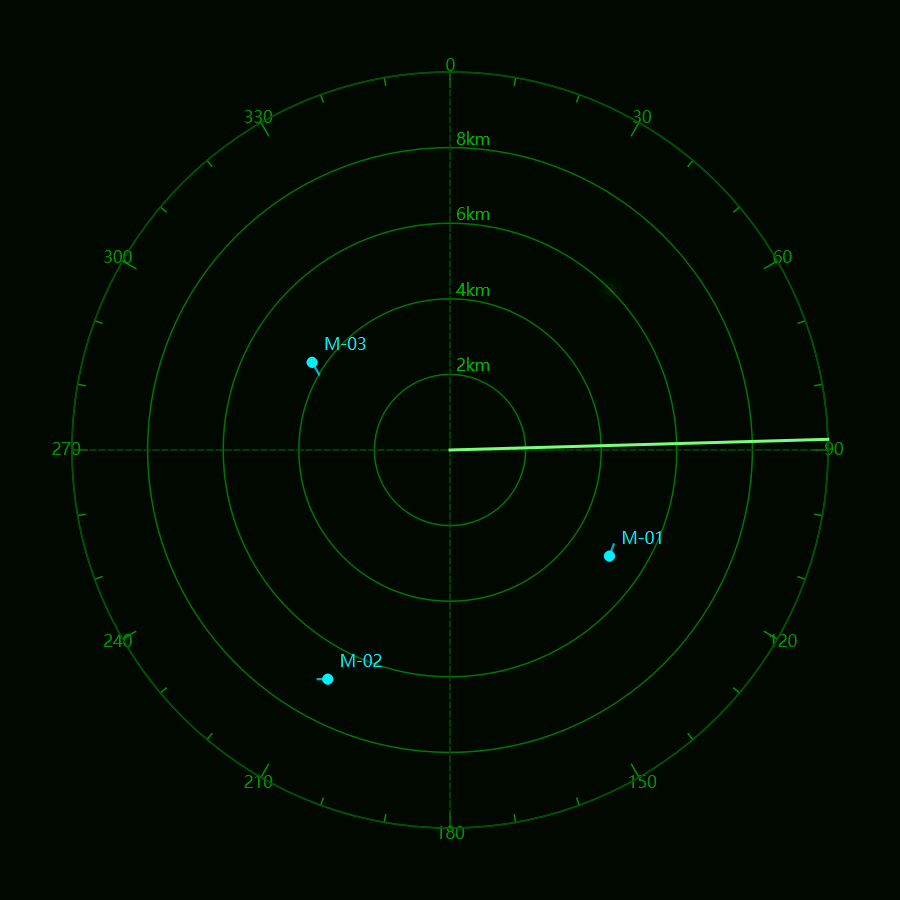
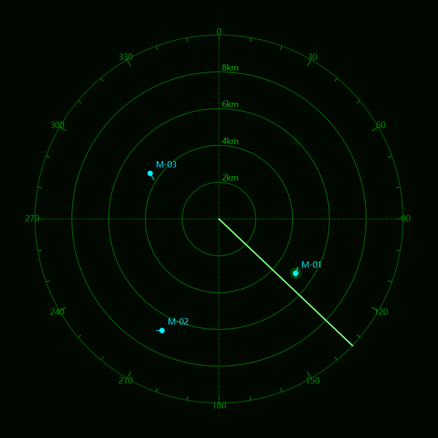
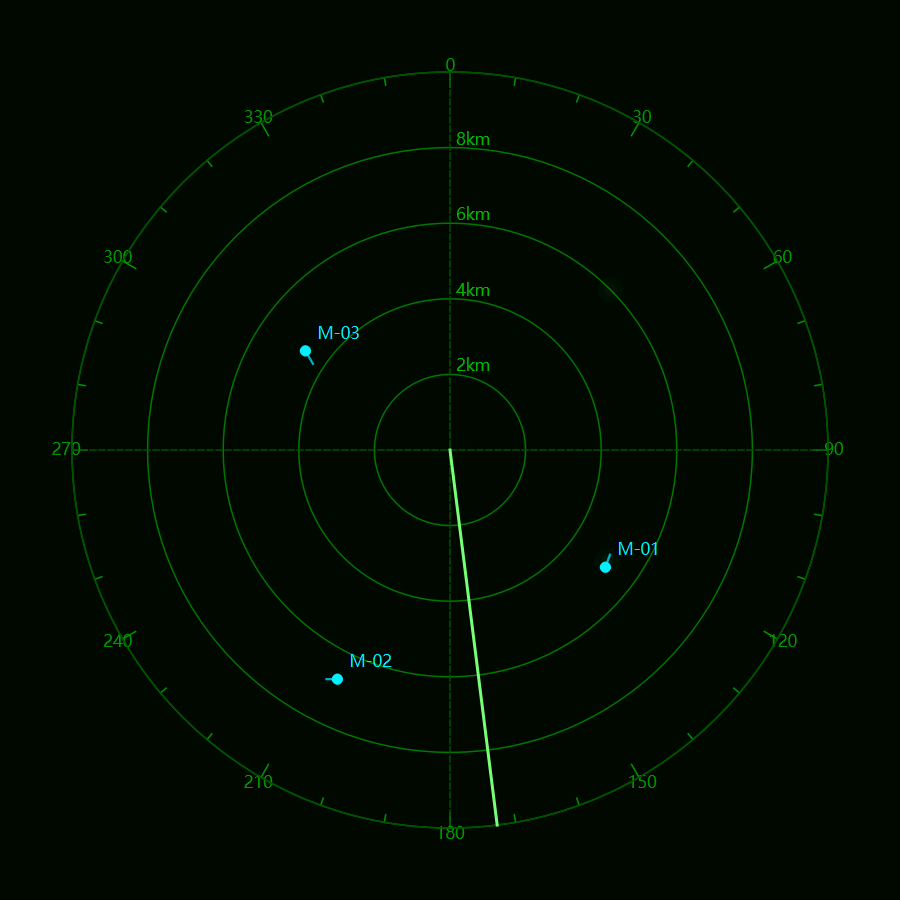

# Radar Simulator · PPI 雷达模拟器

一个基于 **Qt 6 + C++17** 的 PPI 雷达显示器（Plane Position Indicator）模拟程序。用 `QWidget` + `QPainter` 纯代码绘制雷达圆盘、扫描线与荧光余辉，模拟真实雷达对目标的扫描、跟踪与显示过程。

> 纯 QWidget/QPainter 实现，不依赖 QML。

---

## 功能特性

- **PPI 全圆显示**：真实方位角 0–360°，正北 0°、顺时针增大，带距离环、方位刻度、十字线
- **量程可调**：2 / 5 / 10 / 20 km（默认 10 km），距离环步长随量程自适应
- **扫描速度可调**：2 ~ 30 秒/圈（默认 12 秒/圈），真实 `dt` 驱动，帧率无关
- **荧光余辉拖尾**：离屏 `QImage` 逐帧衰减，模拟"扫到才亮、过后淡出"；衰减系数可调
- **多目标管理**：添加 / 删除、自动命名（`TGT-01`…），单个目标表格双向绑定
- **运动模型**：按速度 / 航向匀速直线运动，超出量程自动移除
- **鼠标交互**：点击空白处生成目标，按住目标拖动改位置（带偏移跟随、出界钳制）
- **场景存取**：JSON 格式保存 / 加载，含版本号、量程与目标列表，越界目标自动跳过
- **UDP 航迹数据源**：自定义二进制协议（`RADT` + 版本号 + 记录），支持接收与发送，内置回放演示
- **数据导出**：目标列表导出 CSV，雷达画面导出 PNG
- **状态栏与右键菜单**：实时显示扫描方位与光标极坐标；右键目标可删除 / 编辑属性
- **名称唯一性校验**：改名时校验非空且不重复，失败给出提示
- **单元测试**：7 个 Qt Test 目标、38 个用例，`ctest` 全绿

---

## 界面一览

扫描线旋转、荧光余辉拖尾与目标航迹尾迹的实时演示：


若干运行截图（不同时刻）：

| 时刻 1 | 时刻 2 | 时刻 3 |
| --- | --- | --- |
|  |  |  |

---

## 技术栈

| 项 | 说明 |
| --- | --- |
| 语言 | C++17 |
| 框架 | Qt 6（Widgets + Core） |
| 构建 | CMake 3.19+，MinGW 工具链 |
| 绘图 | QWidget / QPainter（无 QML） |
| 序列化 | Qt JSON（QJsonDocument） |

---

## 构建与运行

### 环境要求

- Qt 6.5 及以上（本项目在 Qt 6.11.1 MinGW 64-bit 下开发验证）
- CMake ≥ 3.19
- MinGW 编译器（`g++` / `mingw32-make`）

### 方式一：Qt Creator（推荐）

1. 用 Qt Creator 打开项目根目录下的 `CMakeLists.txt`
2. 选择 MinGW 构建套件，直接点击「运行」

### 方式二：命令行

```bash
cmake -S . -B build -G "MinGW Makefiles"
cmake --build build
# 运行
./build/Radar_Simulator.exe
```

---

## 项目结构

```
Radar_Simulator/
├── CMakeLists.txt
├── main.cpp                    # 程序入口，组装 UI 与数据层
├── core/                       # 数据与业务逻辑层（不依赖 UI）
│   ├── coordconverter.h/.cpp   # 极坐标 ↔ 屏幕坐标 换算
│   ├── Target.h/.cpp           # 目标数据结构（内部直角坐标，对外极坐标）
│   ├── targetmanager.h/.cpp    # 目标集合、运动推进、出界清理、量程管理
│   ├── simengine.h/.cpp        # 纯逻辑仿真推进引擎（线程无关，便于移入工作线程）
│   ├── ScenarioIO.h/.cpp       # 场景 JSON 读写
│   ├── udpprotocol.h/.cpp      # UDP 航迹报文编解码（自定义二进制协议）
│   ├── udptracksource.h/.cpp   # UDP 航迹接收（数据源）
│   └── udptracksender.h/.cpp   # UDP 航迹发送（回放 / 演示）
├── ui/                         # 界面层
│   ├── radarwidget.h/.cpp      # 雷达绘制：圆盘 / 扫描线 / 余辉 / 鼠标交互
│   └── TargetTableModel.h/.cpp # 目标表格 Model（QAbstractTableModel）
├── tools/                      # 辅助工具
│   ├── gifencoder.h/.cpp       # GIF89a 动画编码（生成演示素材）
│   └── demo_capture.cpp        # 抓帧生成 GIF / PNG
└── tests/                      # Qt Test 单元测试（7 个目标）
```

### 架构要点

- **数据层（core）与 UI 层（ui）分离**：`TargetManager` 作为单一数据源，所有目标变更通过 Qt 信号/槽通知雷达视图和表格
- **坐标唯一入口**：所有极坐标 ↔ 屏幕坐标换算集中在 `CoordConverter`，禁止在其他地方重写 sin/cos
- **荧光余辉用离屏 `QImage` 逐帧压暗**（`CompositionMode_DestinationIn`），而非保存历史点列表——恒定重绘成本，更接近真实荧光屏物理

---

## 场景文件格式（JSON）

```json
{
    "version": 1,
    "maxRangeKm": 10.0,
    "targets": [
        {
            "name": "TGT-01",
            "rangeKm": 6.0,
            "azimuthDeg": 45.0,
            "speedKmh": 0.0,
            "headingDeg": 0.0,
            "autoMove": false
        }
    ]
}
```

- 目标用**极坐标**存储（`rangeKm` / `azimuthDeg`），直观可读
- `version` 字段用于格式兼容性校验，版本不符直接拒绝加载

---

## 操作说明

| 操作 | 效果 |
| --- | --- |
| 双击表格单元格 | 修改目标名称 / 距离 / 方位 / 速度 / 航向 |
| 勾选「自动」 | 目标按速度 / 航向自动运动 |
| 「添加目标」按钮 | 新增一个目标（按 30° 递增方位散开） |
| 「删除选中」按钮 | 删除表格中选中的目标 |
| 点击雷达图空白处 | 在点击位置生成目标 |
| 按住目标拖动 | 移动目标位置（拖出量程会钳制在圆周） |
| 菜单「文件 → 保存/加载场景」 | 场景存到 / 从 JSON 文件恢复 |

---

## License

仅供学习与简历项目展示使用。